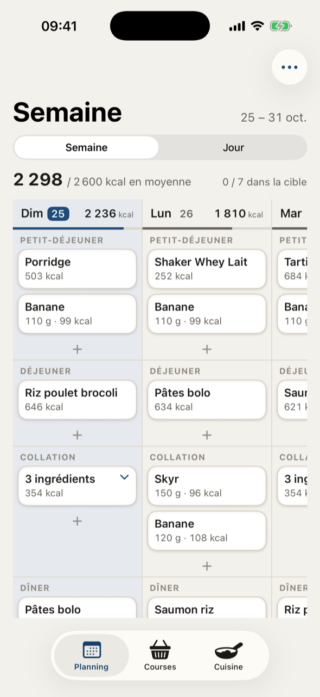
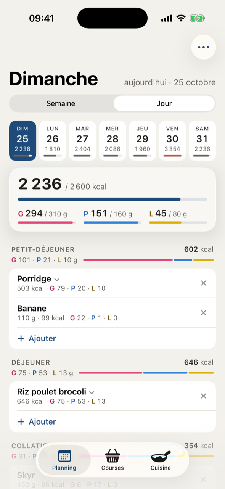
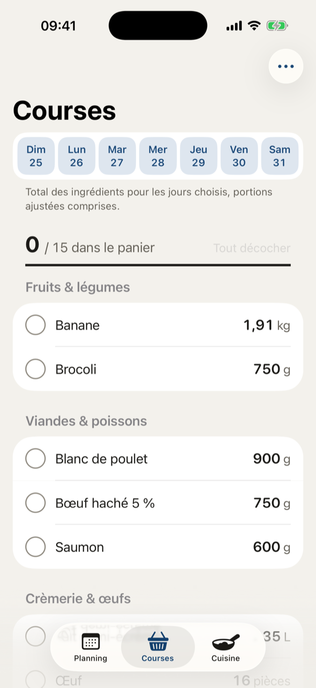
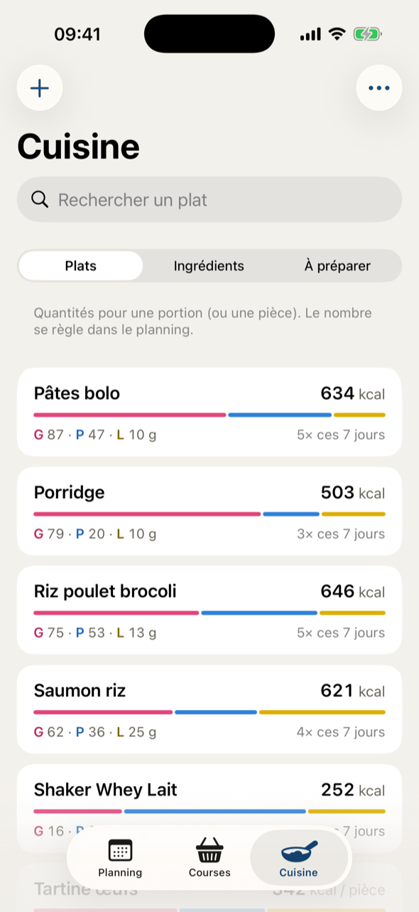

# Semainier

Application iPhone de planification de repas et macros pour mon usage personnel. Design SwiftUI pour iOS 26 (Liquid Glass), données locales avec SwiftData. 


<p align="center">
  
  
  
  
</p>

## Fonctionnalités

- **Planning Semaine** : grille jours × repas qui défile dans les deux sens, en-tête figé avec le total et la jauge de
  chaque jour. Pincer pour une vue d'ensemble de la semaine, tirer au bord pour passer à la semaine voisine,
  glisser un plat pour le dupliquer, appui long pour le copier, le déplacer ou le retirer.
- **Planning Jour** : total du jour face à l'objectif (kcal, glucides, protéines, lipides), repas dépliables,
  quantités modifiables pour un seul plat sans toucher à la recette, copie d'une journée vers d'autres jours.
- **Plats variés** : recettes à la portion ou à la pièce, ingrédients seuls (regroupables en recette d'un appui long),
  repas libres dont on estime seulement les kcal.
- **Courses** : quantités totales par rayon pour les jours choisis, arrondies pour le magasin, à cocher, copier ou
  partager.
- **Cuisine** : recettes, ingrédients, et « À préparer » (portions à cuisiner à l'avance pour les jours choisis).
- **Scan de codes-barres** (VisionKit) avec fiche préremplie depuis [Open Food Facts](https://world.openfoodfacts.org) :
  kcal vérifiées contre les kJ et les macros, rayon et poids d'une pièce devinés.
- **Sauvegarde JSON** : export et import depuis le menu ⋯ (AirDrop, Fichiers).
- Mode sombre, Dynamic Type et VoiceOver pris en charge.

## Prévu / en réflexion  

- Streaks de jours dans la cible
- Template de semaines
- Scan de ticket de caisse pour avoir rapidement les stocks a disposition ? 
- Statistiques 
- Complétion de journée automatique 
- Filtrage de recettes par type d'aliment 
- Onglet communautaire, profil, partage de recette avec macros ?

## Prérequis

- Xcode 26 ou plus récent, iOS 26.
- Un iPhone pour le scan : la caméra n'est pas disponible dans le simulateur (le code se saisit alors à la main).

## Installer sur son iPhone

1. Cloner le dépôt et ouvrir `Semainier.xcodeproj`.
2. Dans la cible **Semainier** › *Signing & Capabilities*, choisir son équipe et remplacer l'identifiant
   `com.ovrplow.Semainier` par le sien (de même pour les cibles de tests). Un compte Apple gratuit suffit.
3. Brancher l'iPhone, le déverrouiller, accepter « Se fier à cet ordinateur », puis activer
   Réglages › Confidentialité et sécurité › **Mode développeur** (l'iPhone redémarre).
4. Lancer `scripts/install-iphone.sh`, ou ▶︎ dans Xcode.
5. Sur l'iPhone : Réglages › Général › VPN et gestion de l'appareil › compte développeur › **Se fier**.

Avec un compte gratuit, la signature expire au bout de 7 jours : relancer `scripts/install-iphone.sh` chaque semaine.
Les données sont conservées tant que l'application n'est pas supprimée. Après le premier branchement, l'installation
marche aussi en Wi-Fi. En cas de changement d'identifiant, le mettre aussi à jour dans `scripts/install-iphone.sh`
et `scripts/shots.sh`.

## Développement

```sh
# Tests unitaires (Swift Testing, ~40 s)
xcodebuild -project Semainier.xcodeproj -scheme Semainier \
  -destination 'platform=iOS Simulator,name=iPhone 17 Pro' test -only-testing:SemainierTests

# Tests d'interface (XCTest, ~2 min) : même commande avec
#   -only-testing:SemainierUITests

# Captures du simulateur par écran
scripts/shots.sh <dossier> planning:semaine planning:jour courses recettes ingredients
```

Arguments de lancement (builds Debug) :

| Argument | Effet |
|---|---|
| `-UITestData` | Base en mémoire avec une recette de test (tests d'interface) |
| `-PerfData` | Base en mémoire avec un an de planning (~2 500 plats), pour mesurer les performances |
| `-DisableAnimations` | Coupe les animations UIKit (obligatoire pour les tests d'interface) |
| `-tab`, `-planning.mode`, `-cuisine.mode` | Ouvre un onglet ou une vue précise |

Les bases de test sont toujours en mémoire : elles ne touchent jamais aux vraies données.

### Organisation

| Dossier | Contenu |
|---|---|
| `Semainier/Core/` | Logique pure, sans SwiftData ni SwiftUI : nutrition, dates (`DayKey` AAAAMMJJ), repas, formatage français |
| `Semainier/Model/` | Modèle SwiftData versionné, actions sur le planning, index par jour, liste de courses, préparation, sauvegarde JSON |
| `Semainier/Planning/` | Vues Semaine (grille `UICollectionView` avec contenu SwiftUI) et Jour, feuilles d'ajout et de modification |
| `Semainier/Shopping/` | Liste de courses |
| `Semainier/Recipes/`, `Semainier/Ingredients/` | Onglet Cuisine : recettes, ingrédients, « À préparer » |
| `Semainier/Scan/` | Caméra VisionKit, client Open Food Facts, enchaînement scan → fiche |
| `Semainier/UI/` | Thème (couleurs, typographie, rayons), composants, préférences, barre d'outils commune |

Conventions du projet (tokens de couleur, nommage en français, schéma versionné, journalisation des erreurs…) :
voir [`CLAUDE.md`](CLAUDE.md).

## Données et iCloud

Les données restent sur l'iPhone. Le modèle est déjà compatible CloudKit : avec un compte développeur payant, il
suffit d'ajouter la capacité iCloud (CloudKit) à la cible et de remplacer `cloudKitDatabase: .none` par `.automatic`
dans `SemainierApp.swift` pour synchroniser entre appareils.

## Crédits

Données produits : [Open Food Facts](https://world.openfoodfacts.org), sous licence
[Open Database License](https://opendatacommons.org/licenses/odbl/1-0/).
